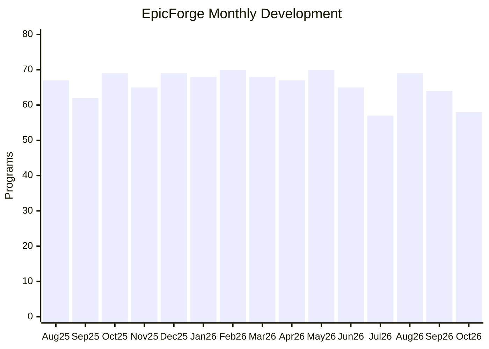

# MIDI Programming Archive — Development History

This repository contains 1,000 Python MIDI programming files.
The files were imported into Git on October 27, 2026.

Development dates were reported from archived file records.
They are not historical Git commit dates.
The date metadata requires independent source verification.

## Recorded development timeline

| Month | Files aligned with recorded date |
|---|---:|
| 2025-08 | 67 |
| 2025-09 | 62 |
| 2025-10 | 69 |
| 2025-11 | 65 |
| 2025-12 | 69 |
| 2026-01 | 68 |
| 2026-02 | 70 |
| 2026-03 | 68 |
| 2026-04 | 67 |
| 2026-05 | 70 |
| 2026-06 | 65 |
| 2026-07 | 57 |
| 2026-08 | 69 |
| 2026-09 | 64 |
| 2026-10 | 58 |

- Files aligned with recorded dates: 988
- Future-dated records requiring review: 12
- Missing files: 0
- Other folder mismatches: 0

## Reported date sources

- Claude Code session: 443
- Google Drive version history: 362
- Original file backup: 195

Original Google Drive history, Claude Code sessions, and
backup records should be retained to support these dates.

## Historical development graph

Author-reported development dates, not historical Git commits.

12 additional records require date review.
